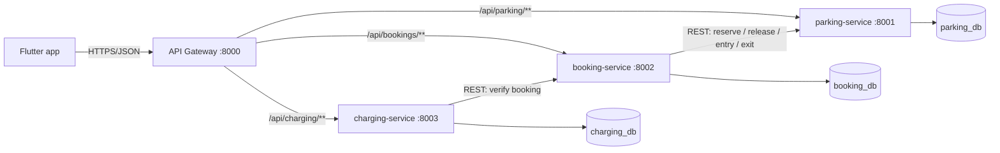
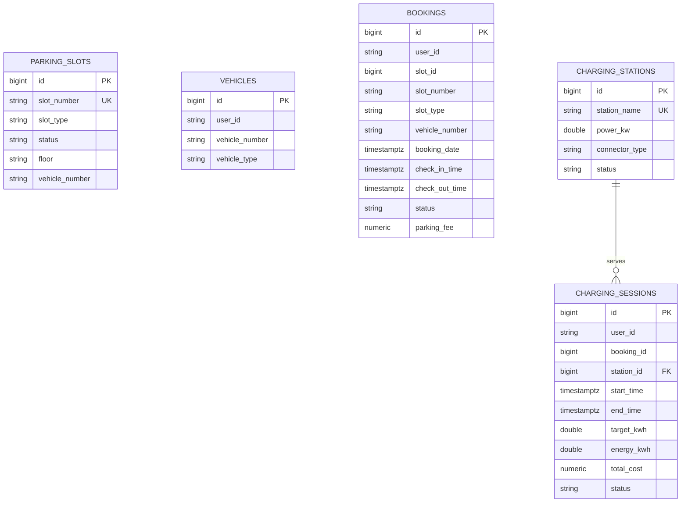
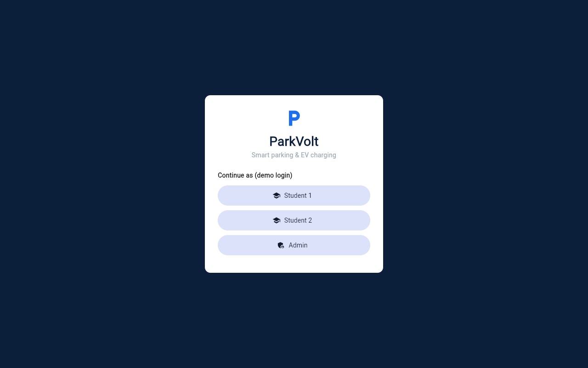

# ParkVolt architecture

## Components

One Postgres 16 container hosts three databases, each owned by its own user. Services only talk to each other over REST (`RestClient`, 2 s connect / 3 s read timeouts).

## Data model

`bookings.slot_id` and `charging_sessions.booking_id` are plain columns: there are no cross-database foreign keys. `slot_number` / `slot_type` are snapshotted into the booking so charging can check EV eligibility from the booking alone.

## State machines

- Slot: `AVAILABLE > RESERVED > OCCUPIED > AVAILABLE`, `RESERVED > AVAILABLE`, `AVAILABLE <> UNAVAILABLE`
- Booking: `CONFIRMED > ACTIVE > COMPLETED`, `CONFIRMED > CANCELLED`
- Station: `AVAILABLE > CHARGING > AVAILABLE`, `AVAILABLE <> OFFLINE`

Anything else returns 409.

## Consistency and fault isolation (viva talking points)

- **Atomic reserve.** Parking reserves with one `UPDATE ... SET status='RESERVED' WHERE id=? AND status='AVAILABLE'`. The affected-row count decides the winner (1 = success, 0 = 409 `SLOT_NOT_AVAILABLE`). Charging claims stations the same way. Test: `ReserveConcurrencyTest` fires 8 threads at one slot and exactly one succeeds.
- **Compensation.** Booking reads the slot, reserves it in parking, then saves the booking. If the save fails it releases the slot (best effort) and returns 500. If parking is unreachable it returns 503 and saves nothing. Cancel, check-in and complete call parking first, so an outage leaves the booking unchanged.
- **Database backstops.** Partial unique indexes: one open booking per slot, one active session per station.
- **Fault isolation.** A dead downstream becomes `503 {"error":"SERVICE_UNAVAILABLE","service":"..."}` (from the services and from the gateway). Stopping charging-service leaves parking and booking working, and `/api/health` reports `DEGRADED`.
- **Live charging.** Energy and cost are computed from timestamps on every read, so there is no background thread: `energyKwh = powerKw * minutes/60 * multiplier`, `cost = energyKwh * 8`.

## API summary (through the gateway, base `/api`)

| Area | Endpoints |
|---|---|
| Parking `/parking` | `GET /slots`, `/slots/available`, `/slots/{id}`; `POST /slots` (admin); `DELETE /slots/{id}` (admin); `PATCH /slots/{id}/status` (admin); `POST /slots/{id}/reserve`, `/release`, `/entry`, `/exit` |
| Bookings `/bookings` | `POST /`; `GET /` (admin); `GET /{id}`; `GET /user/{userId}`; `PATCH /{id}/cancel`, `/check-in`, `/complete` |
| Charging `/charging` | `GET /stations`, `/stations/available`; `PATCH /stations/{id}/status` (admin); `POST /sessions/start`; `GET /sessions[?userId=]`, `/sessions/{id}`; `PATCH /sessions/{id}/stop` |
| Gateway | `GET /api/health` (aggregated) |

Errors share one shape: `{ "timestamp", "status", "error", "message" }`.

## Screenshots

